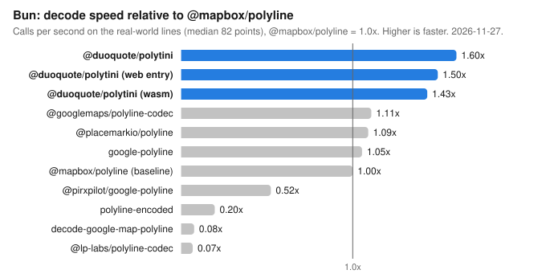
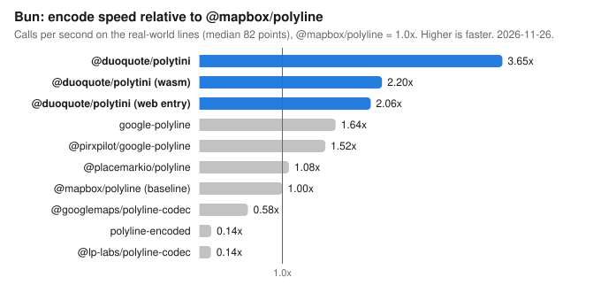

# polyline-benchmark

<p align="center">
  <a href="https://github.com/Duoquote/polyline-benchmark/actions/workflows/ci.yml"></a>
  <a href="docs/methodology.md#whats-in-the-comparison"></a>
  <a href="#results"></a>
  <a href="results"></a>
  <a href="LICENSE"></a>
</p>

Speed and memory of the JavaScript libraries that encode and decode Google's [encoded polyline format](https://developers.google.com/maps/documentation/utilities/polylinealgorithm), the strings Google Maps, OSRM, Valhalla and GraphHopper return for route geometry. Every library passes the same correctness test before it's timed, then runs through the same harness on Bun, Node 22 to 26, Deno and Chrome. I started it in 2021 with five decoders; [polytini](https://github.com/Duoquote/polytini) is the codec I wrote while rebuilding it in 2026, so read its rows knowing that.

<!-- charts:top -->
<picture>
  <source media="(prefers-color-scheme: dark)" srcset="docs/charts/speed-bun-decode-dark.svg">
  
</picture>
<picture>
  <source media="(prefers-color-scheme: dark)" srcset="docs/charts/speed-bun-encode-dark.svg">
  
</picture>
<!-- /charts:top -->

## Best at what

Across all 8 runtimes (geometric mean over runtimes and sizes):

<!-- best -->
| Situation | Best | Runner-up | Margin |
|---|---|---|--:|
| Decode short lines (10 and 100 points) | @googlemaps/polyline-codec | @mapbox/polyline | 1.05x faster, within the noise |
| Decode long lines (10,000 and 100,000 points) | **@duoquote/polytini** | @googlemaps/polyline-codec | 1.14x faster, within the noise |
| Decode real-world lines (median 82 points) | **@duoquote/polytini** | @googlemaps/polyline-codec | 1.22x faster, within the noise |
| Encode, any length | **@duoquote/polytini** | google-polyline | 2.05x faster |
| Decode to typed arrays | **@duoquote/polytini (wasm, Float64Array)** | @duoquote/polytini (Float64Array) | 1.08x faster, within the noise |
| Encode from typed arrays | **@duoquote/polytini (wasm, Float64Array)** | @duoquote/polytini (Float64Array) | 1.05x faster, within the noise |
| Decode 1000 lines in one call | **@duoquote/polytini (wasm decodeMany/encodeMany)** | @duoquote/polytini (wasm, Float64Array) | 1.61x faster |
| Least memory per decode (10,000 points, [lat, lng] arrays) | **@duoquote/polytini (765.4 KB)** | @googlemaps/polyline-codec (766.2 KB) | 0.1% less |
| Smallest bundle (gzipped) | google-polyline (551 B) | @googlemaps/polyline-codec (568 B) | 17 B smaller |
| Strict validation (throws on bad input) | **@duoquote/polytini** | @lp-labs/polyline-codec | 15x faster |
| HERE Flexible Polyline (encode and decode) | **@duoquote/polytini (flexible)** | @here/flexpolyline | 24x faster |
<!-- /best -->

## Results

Calls per second, higher is better, fastest first, the fastest in each column in bold. A call is one `encode()` or `decode()` of one line. Between rounds a cell moved by a median of <!-- spread -->29% to 35%<!-- /spread --> depending on the runtime. That's a lot: the whole run takes 10 minutes on a desktop with other apps open. So a gap under about 30% between the top libraries isn't a reliable ranking, and a rerun can flip it; the best-at-what table marks those. Relative numbers (`@mapbox/polyline` = 1.0x), typed arrays, batch calls, memory and sizes are in [docs/results.md](docs/results.md), and every chart is in [docs/charts.md](docs/charts.md).

### Bun

<!-- results:bun -->
Bun v1.4.3, 2026-11-26. `@duoquote/polytini` resolved to `src/bun.js`. Between rounds a cell moved by a median of 33%, 224% at worst.

| decode, calls/s | 10 pts | 100 pts | 1,000 pts | 10,000 pts | 100,000 pts | real-world line |
|---|--:|--:|--:|--:|--:|--:|
| **@duoquote/polytini@0.1.0 (web entry)** | 8.10M | **949k** | **99.9k** | 9.47k | 815 | 425k |
| **@duoquote/polytini@0.1.0** | 6.60M | 716k | 84.3k | **10.9k** | **937** | **459k** |
| @googlemaps/polyline-codec@1.0.28 | **9.55M** | 919k | 93.0k | 9.24k | 640 | 286k |
| **@duoquote/polytini@0.1.0 (wasm)** | 7.39M | 766k | 75.4k | 7.54k | 713 | 348k |
| google-polyline@2.0.0 | 8.25M | 825k | 72.6k | 7.77k | 540 | 271k |
| @placemarkio/polyline@2.0.3 | 7.38M | 610k | 61.9k | 7.52k | 646 | 267k |
| @mapbox/polyline@1.2.1 | 7.40M | 757k | 66.1k | 6.07k | 628 | 256k |
| @pirxpilot/google-polyline@4.0.1 | 2.36M | 382k | 36.0k | 2.97k | 233 | 124k |
| polyline-encoded@0.0.9 | 1.06M | 107k | 11.7k | 988 | 92.6 | 64.7k |
| @lp-labs/polyline-codec@0.1.0 | 436k | 41.5k | 4.17k | 387 | 22.7 | 21.1k |
| decode-google-map-polyline@1.0.1 | 293k | 31.3k | 3.43k | 374 | 30.5 | 22.8k |

| encode, calls/s | 10 pts | 100 pts | 1,000 pts | 10,000 pts | 100,000 pts | real-world line |
|---|--:|--:|--:|--:|--:|--:|
| **@duoquote/polytini@0.1.0** | **8.47M** | **1.75M** | **173k** | **14.8k** | **1.34k** | **470k** |
| **@duoquote/polytini@0.1.0 (wasm)** | 4.25M | 1.46M | 152k | 10.6k | 995 | 283k |
| **@duoquote/polytini@0.1.0 (web entry)** | 4.61M | 697k | 71.8k | 6.16k | 479 | 266k |
| google-polyline@2.0.0 | 5.30M | 720k | 64.2k | 4.75k | 356 | 211k |
| @pirxpilot/google-polyline@4.0.1 | 4.20M | 628k | 65.7k | 3.74k | 372 | 195k |
| @placemarkio/polyline@2.0.3 | 2.83M | 309k | 28.3k | 2.79k | 216 | 139k |
| @mapbox/polyline@1.2.1 | 2.68M | 236k | 26.0k | 2.40k | 180 | 129k |
| @googlemaps/polyline-codec@1.0.28 | 1.35M | 171k | 16.0k | 1.55k | 137 | 75.2k |
| @lp-labs/polyline-codec@0.1.0 | 402k | 31.3k | 3.62k | 316 | 27.2 | 18.0k |
| polyline-encoded@0.0.9 | 270k | 29.8k | 3.07k | 257 | 24.0 | 18.5k |
<!-- /results:bun -->

### Node 24

<!-- results:node-24 -->
Node v24.22.3, 2026-11-26. `@duoquote/polytini` resolved to `src/node.js`. Between rounds a cell moved by a median of 32%, 70% at worst.

| decode, calls/s | 10 pts | 100 pts | 1,000 pts | 10,000 pts | 100,000 pts | real-world line |
|---|--:|--:|--:|--:|--:|--:|
| **@duoquote/polytini@0.1.0** | 6.50M | 760k | 74.4k | 7.21k | **581** | **410k** |
| @googlemaps/polyline-codec@1.0.28 | 6.66M | **872k** | 71.8k | 6.72k | 460 | 326k |
| **@duoquote/polytini@0.1.0 (web entry)** | 5.44M | 865k | **74.6k** | **7.62k** | 496 | 302k |
| **@duoquote/polytini@0.1.0 (wasm)** | 5.28M | 694k | 70.3k | 6.65k | 519 | 340k |
| @placemarkio/polyline@2.0.3 | **7.50M** | 681k | 64.8k | 7.03k | 403 | 306k |
| @mapbox/polyline@1.2.1 | 7.00M | 608k | 60.3k | 6.67k | 368 | 254k |
| google-polyline@2.0.0 | 5.09M | 595k | 56.7k | 5.84k | 332 | 254k |
| @pirxpilot/google-polyline@4.0.1 | 5.78M | 627k | 56.5k | 5.13k | 312 | 254k |
| polyline-encoded@0.0.9 | 1.72M | 161k | 14.5k | 1.36k | 99.8 | 81.5k |
| @lp-labs/polyline-codec@0.1.0 | 531k | 66.5k | 5.68k | 489 | 37.5 | 27.1k |
| decode-google-map-polyline@1.0.1 | 131k | 25.1k | 2.36k | 260 | 17.5 | 15.7k |

| encode, calls/s | 10 pts | 100 pts | 1,000 pts | 10,000 pts | 100,000 pts | real-world line |
|---|--:|--:|--:|--:|--:|--:|
| **@duoquote/polytini@0.1.0** | **5.74M** | 898k | 117k | **10.8k** | **918** | **346k** |
| **@duoquote/polytini@0.1.0 (wasm)** | 4.08M | **1.35M** | **144k** | 7.96k | 706 | 264k |
| **@duoquote/polytini@0.1.0 (web entry)** | 3.89M | 579k | 63.2k | 6.43k | 448 | 301k |
| @pirxpilot/google-polyline@4.0.1 | 4.44M | 483k | 55.8k | 4.42k | 438 | 182k |
| google-polyline@2.0.0 | 4.41M | 522k | 54.1k | 4.12k | 368 | 172k |
| @placemarkio/polyline@2.0.3 | 3.45M | 477k | 49.7k | 4.14k | 329 | 172k |
| @mapbox/polyline@1.2.1 | 2.90M | 470k | 41.0k | 3.39k | 295 | 152k |
| @googlemaps/polyline-codec@1.0.28 | 1.67M | 210k | 17.8k | 1.02k | 82.7 | 73.5k |
| @lp-labs/polyline-codec@0.1.0 | 673k | 83.3k | 7.05k | 605 | 41.7 | 35.3k |
| polyline-encoded@0.0.9 | 230k | 22.9k | 2.32k | 218 | 19.9 | 13.1k |
<!-- /results:node-24 -->

Node 22, 23, 25 and 26, Deno, and Chrome with the Maps JavaScript API's own encoder: [docs/results.md](docs/results.md).

## Running it

```sh
npm ci
npm test              # correctness, every library
npm run bench:all     # everything, about 10 minutes
npm run bench:quick   # about a minute, for checking changes
```

How it's measured, the library list and what's left out: [docs/methodology.md](docs/methodology.md).

## License

MIT, see [LICENSE](LICENSE).
