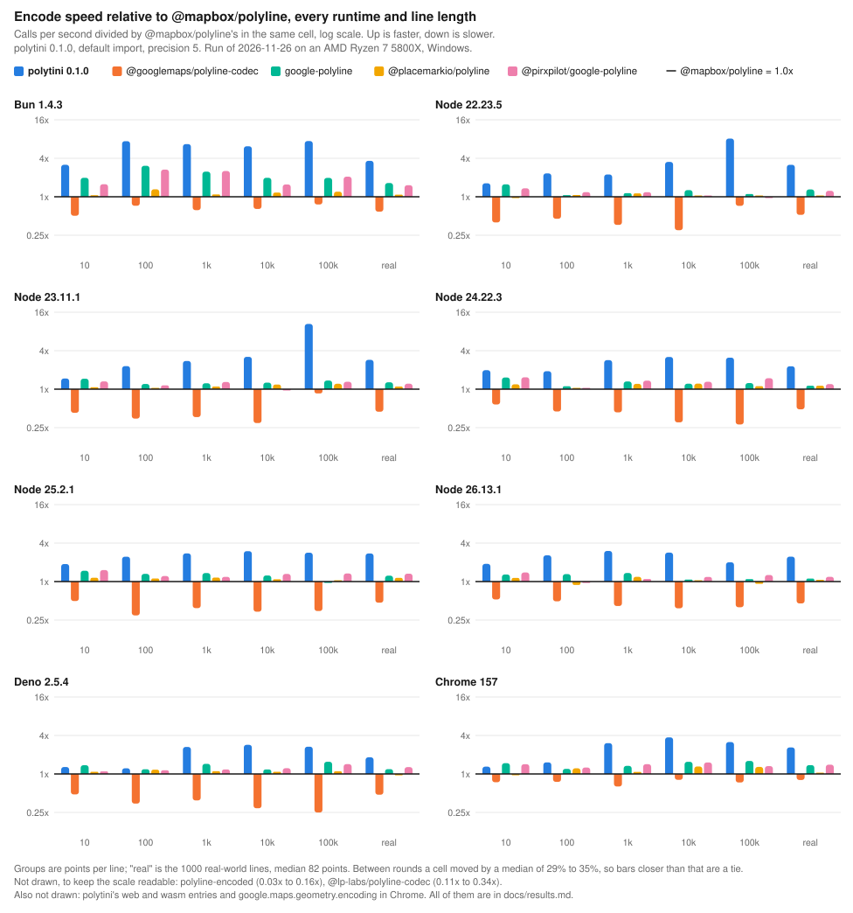

# polyline-benchmark

<p align="center">
  <a href="https://github.com/Duoquote/polyline-benchmark/actions/workflows/ci.yml"></a>
  <a href="docs/methodology.md#whats-in-the-comparison"></a>
  <a href="#results"></a>
  <a href="results"></a>
  <a href="LICENSE"></a>
</p>

Speed and memory of the JavaScript libraries that encode and decode Google's [encoded polyline format](https://developers.google.com/maps/documentation/utilities/polylinealgorithm), the strings Google Maps, OSRM, Valhalla and GraphHopper return for route geometry. Every library passes the same correctness test before it's timed, then runs through the same harness on Bun, Node 22 to 26, Deno and Chrome. I started it in 2021 with five decoders; [polytini](https://github.com/Duoquote/polytini) is the codec I wrote while rebuilding it in 2026, so read its rows knowing that.

<!-- charts:top -->
<picture>
  <source media="(prefers-color-scheme: dark)" srcset="docs/charts/overview-dark.svg">
  
</picture>
<picture>
  <source media="(prefers-color-scheme: dark)" srcset="docs/charts/grouped-decode-dark.svg">
  
</picture>
<picture>
  <source media="(prefers-color-scheme: dark)" srcset="docs/charts/grouped-encode-dark.svg">
  
</picture>
<!-- /charts:top -->

## Best at what

Across all 8 runtimes (geometric mean over runtimes and sizes):

<!-- best -->
| Situation | Best | Runner-up | Margin |
|---|---|---|--:|
| Decode short lines (10 and 100 points) | **@duoquote/polytini** | @placemarkio/polyline | 1.01x faster, within the noise |
| Decode long lines (10,000 and 100,000 points) | **@duoquote/polytini** | @googlemaps/polyline-codec | 1.20x faster |
| Decode real-world lines (median 82 points) | **@duoquote/polytini** | @googlemaps/polyline-codec | 1.27x faster |
| Encode, any length | **@duoquote/polytini** | google-polyline | 2.01x faster |
| Decode to typed arrays | **@duoquote/polytini (Float64Array)** | @duoquote/polytini (wasm, Float64Array) | 1.00x faster, within the noise |
| Encode from typed arrays | **@duoquote/polytini (wasm, Float64Array)** | @duoquote/polytini (Float64Array) | 1.03x faster, within the noise |
| Decode 1000 lines in one call | **@duoquote/polytini (wasm decodeMany/encodeMany)** | @duoquote/polytini (wasm, Float64Array) | 1.57x faster |
| Least memory per decode (10,000 points, [lat, lng] arrays) | **@duoquote/polytini (764.8 KB)** | @googlemaps/polyline-codec (766.2 KB) | 0.2% less |
| Smallest bundle, decode only (gzipped) | @placemarkio/polyline (230 B) | @googlemaps/polyline-codec (252 B) | 22 B smaller |
| Smallest bundle, decode and encode (gzipped) | @placemarkio/polyline (424 B) | google-polyline (464 B) | 40 B smaller |
| Strict validation (throws on bad input) | **@duoquote/polytini** | @lp-labs/polyline-codec | 17x faster |
| HERE Flexible Polyline (encode and decode) | **@duoquote/polytini (flexible)** | @here/flexpolyline | 25x faster |
<!-- /best -->

## Since the 27 November run

That run had polytini 0.1.0 from GitHub and a busy machine, so a cell moved by about 30% between rounds and most decode cells were ties. This one has polytini 0.1.4 from npm, one runtime at a time on pinned cores, and cells moved by 5 to 7% ([methodology](docs/methodology.md#how-its-measured)). What changed:

- Decode, short lines: `@googlemaps/polyline-codec` led before, by 1.05x. polytini leads now, by 1.01x over `@placemarkio/polyline`, which is still a tie. Cell by cell, polytini is behind at 10 points on every runtime except Bun, by 11 to 21%. At 100 points it's ahead on Bun, Node 22 and 24, even on Node 23 and 26, and 6 to 12% behind on Node 25, Deno and Chrome.
- Decode, long and real-world lines: 1.14x and 1.22x before, both inside the noise. 1.20x and 1.27x now, outside it.
- Encode: 2.05x before, 2.01x now, ahead of `google-polyline` both times.
- Decode to typed arrays: polytini's WASM build led by 1.08x before. Its JS and WASM builds are even now.
- The heatmap: 49 cells faster, 3 slower and 44 inside the noise before. 70 faster, 13 slower and 13 inside the noise now. Most of that is the quieter machine turning ties into results, in both directions. The 13 slower cells are all decode, mostly at 10 points and in Chrome.

polytini 0.1.4 made short lines faster when a precision is passed, which the benchmark does for every library, and changed how its Node, Bun and Deno builds copy and make strings ([changelog](https://github.com/Duoquote/polytini/blob/main/CHANGELOG.md#014)). Its own paired runs measured 8 to 33% on 10-point lines. Two runs this far apart in noise can't confirm numbers that small cell by cell, but the biggest moves line up with it: against `@mapbox/polyline`, 10-point decode on Node 22 went from 0.64x to 0.89x, 10-point encode on Node 22 and 23 from 1.63x and 1.47x to 2.29x and 2.39x, and encode at 100 points on Deno from 1.23x to 2.09x.

## Results

Calls per second, higher is better, fastest first, the fastest in each column in bold. A call is one `encode()` or `decode()` of one line. Between rounds a cell moved by a median of <!-- spread -->5% to 7%<!-- /spread --> depending on the runtime, so a gap smaller than that between the top libraries isn't a reliable ranking; the heatmap hatches those cells and the best-at-what table marks them. Relative numbers (`@mapbox/polyline` = 1.0x), typed arrays, batch calls, memory and sizes are in [docs/results.md](docs/results.md), and every chart is in [docs/charts.md](docs/charts.md).

<details>
<summary>Bun</summary>

<!-- results:bun -->
Bun v1.4.3, 2026-11-27. `@duoquote/polytini` resolved to `src/bun.js`. Between rounds a cell moved by a median of 7%, 220% at worst.

| decode, calls/s | 10 pts | 100 pts | 1,000 pts | 10,000 pts | 100,000 pts | real-world line |
|---|--:|--:|--:|--:|--:|--:|
| **@duoquote/polytini@0.1.4** | 11.0M | 1.38M | 138k | **13.6k** | **1.31k** | **589k** |
| **@duoquote/polytini@0.1.4 (wasm)** | 11.3M | 1.43M | **139k** | 12.9k | 1.20k | 527k |
| **@duoquote/polytini@0.1.4 (web entry)** | **11.4M** | **1.44M** | 134k | 12.9k | 1.17k | 549k |
| @googlemaps/polyline-codec@1.0.28 | 11.0M | 1.21M | 120k | 11.3k | 1.04k | 407k |
| @placemarkio/polyline@2.0.3 | 11.1M | 1.05M | 103k | 10.6k | 965 | 401k |
| google-polyline@2.0.0 | 10.3M | 969k | 92.7k | 9.57k | 899 | 387k |
| @mapbox/polyline@1.2.1 | 9.42M | 941k | 90.4k | 8.93k | 775 | 367k |
| @pirxpilot/google-polyline@4.0.1 | 3.83M | 440k | 42.5k | 4.12k | 374 | 192k |
| polyline-encoded@0.0.9 | 1.14M | 121k | 12.3k | 1.26k | 121 | 72.0k |
| decode-google-map-polyline@1.0.1 | 407k | 44.0k | 4.60k | 453 | 38.1 | 27.9k |
| @lp-labs/polyline-codec@0.1.0 | 505k | 48.6k | 4.87k | 441 | 28.4 | 24.8k |

| encode, calls/s | 10 pts | 100 pts | 1,000 pts | 10,000 pts | 100,000 pts | real-world line |
|---|--:|--:|--:|--:|--:|--:|
| **@duoquote/polytini@0.1.4** | **9.82M** | **1.82M** | **192k** | **16.4k** | **1.60k** | **578k** |
| **@duoquote/polytini@0.1.4 (wasm)** | 5.95M | 1.57M | 162k | 11.5k | 1.10k | 374k |
| **@duoquote/polytini@0.1.4 (web entry)** | 6.06M | 906k | 93.2k | 9.04k | 850 | 391k |
| google-polyline@2.0.0 | 6.44M | 912k | 79.3k | 6.10k | 592 | 260k |
| @pirxpilot/google-polyline@4.0.1 | 6.80M | 786k | 83.0k | 5.59k | 563 | 252k |
| @placemarkio/polyline@2.0.3 | 3.98M | 494k | 46.8k | 3.87k | 361 | 188k |
| @mapbox/polyline@1.2.1 | 3.55M | 405k | 39.8k | 3.65k | 291 | 154k |
| @googlemaps/polyline-codec@1.0.28 | 1.55M | 202k | 18.8k | 1.76k | 160 | 84.4k |
| @lp-labs/polyline-codec@0.1.0 | 501k | 51.1k | 4.99k | 451 | 34.4 | 24.4k |
| polyline-encoded@0.0.9 | 359k | 35.9k | 3.64k | 337 | 30.5 | 22.5k |
<!-- /results:bun -->

</details>

<details>
<summary>Node 22</summary>

<!-- results:node-22 -->
Node v22.23.5, 2026-11-27. `@duoquote/polytini` resolved to `src/node.js`. Between rounds a cell moved by a median of 7%, 83% at worst.

| decode, calls/s | 10 pts | 100 pts | 1,000 pts | 10,000 pts | 100,000 pts | real-world line |
|---|--:|--:|--:|--:|--:|--:|
| **@duoquote/polytini@0.1.4** | 7.56M | **1.19M** | **125k** | **12.0k** | 288 | **457k** |
| @mapbox/polyline@1.2.1 | **8.52M** | 933k | 82.1k | 8.33k | **291** | 356k |
| @placemarkio/polyline@2.0.3 | 8.30M | 934k | 82.6k | 8.13k | 235 | 349k |
| **@duoquote/polytini@0.1.4 (web entry)** | 7.53M | 1.03M | 99.4k | 9.12k | 165 | 369k |
| @googlemaps/polyline-codec@1.0.28 | 6.57M | 1.06M | 106k | 9.53k | 162 | 373k |
| **@duoquote/polytini@0.1.4 (wasm)** | 7.56M | 1.02M | 95.9k | 8.86k | 162 | 381k |
| google-polyline@2.0.0 | 7.38M | 840k | 71.6k | 7.13k | 217 | 324k |
| @pirxpilot/google-polyline@4.0.1 | 6.67M | 725k | 65.8k | 6.67k | 238 | 298k |
| polyline-encoded@0.0.9 | 1.89M | 227k | 20.4k | 1.99k | 54.0 | 117k |
| @lp-labs/polyline-codec@0.1.0 | 525k | 68.2k | 6.03k | 491 | 32.3 | 30.7k |
| decode-google-map-polyline@1.0.1 | 126k | 19.9k | 2.12k | 196 | 12.8 | 13.6k |

| encode, calls/s | 10 pts | 100 pts | 1,000 pts | 10,000 pts | 100,000 pts | real-world line |
|---|--:|--:|--:|--:|--:|--:|
| **@duoquote/polytini@0.1.4** | **7.09M** | **1.18M** | **128k** | **11.7k** | **1.10k** | **499k** |
| **@duoquote/polytini@0.1.4 (wasm)** | 4.97M | 1.00M | 104k | 7.66k | 781 | 357k |
| **@duoquote/polytini@0.1.4 (web entry)** | 5.01M | 681k | 74.4k | 7.52k | 387 | 429k |
| google-polyline@2.0.0 | 5.08M | 668k | 63.4k | 4.97k | 154 | 231k |
| @pirxpilot/google-polyline@4.0.1 | 4.16M | 579k | 66.6k | 5.14k | 155 | 229k |
| @placemarkio/polyline@2.0.3 | 3.36M | 552k | 51.5k | 4.35k | 133 | 187k |
| @mapbox/polyline@1.2.1 | 3.10M | 490k | 45.5k | 3.94k | 128 | 175k |
| @googlemaps/polyline-codec@1.0.28 | 1.55M | 216k | 18.9k | 1.22k | 103 | 87.7k |
| @lp-labs/polyline-codec@0.1.0 | 703k | 92.6k | 8.10k | 679 | 45.0 | 36.0k |
| polyline-encoded@0.0.9 | 166k | 17.2k | 1.66k | 165 | 15.9 | 10.5k |
<!-- /results:node-22 -->

</details>

<details>
<summary>Node 23</summary>

<!-- results:node-23 -->
Node v23.11.1, 2026-11-27. `@duoquote/polytini` resolved to `src/node.js`. Between rounds a cell moved by a median of 6%, 116% at worst.

| decode, calls/s | 10 pts | 100 pts | 1,000 pts | 10,000 pts | 100,000 pts | real-world line |
|---|--:|--:|--:|--:|--:|--:|
| **@duoquote/polytini@0.1.4** | 8.11M | **1.20M** | **130k** | **12.7k** | **400** | **481k** |
| @placemarkio/polyline@2.0.3 | 9.28M | 990k | 88.5k | 8.65k | 334 | 355k |
| @googlemaps/polyline-codec@1.0.28 | 7.45M | 1.15M | 115k | 10.5k | 179 | 371k |
| @mapbox/polyline@1.2.1 | **9.91M** | 967k | 85.2k | 8.85k | 239 | 359k |
| **@duoquote/polytini@0.1.4 (wasm)** | 8.18M | 1.06M | 99.1k | 9.12k | 173 | 388k |
| **@duoquote/polytini@0.1.4 (web entry)** | 8.12M | 1.05M | 100k | 9.35k | 171 | 382k |
| google-polyline@2.0.0 | 8.25M | 920k | 79.2k | 7.73k | 230 | 320k |
| @pirxpilot/google-polyline@4.0.1 | 7.32M | 762k | 69.7k | 6.97k | 286 | 302k |
| polyline-encoded@0.0.9 | 1.85M | 223k | 20.5k | 2.07k | 63.1 | 118k |
| @lp-labs/polyline-codec@0.1.0 | 561k | 70.5k | 6.45k | 532 | 32.1 | 33.2k |
| decode-google-map-polyline@1.0.1 | 135k | 22.9k | 2.36k | 216 | 14.0 | 15.1k |

| encode, calls/s | 10 pts | 100 pts | 1,000 pts | 10,000 pts | 100,000 pts | real-world line |
|---|--:|--:|--:|--:|--:|--:|
| **@duoquote/polytini@0.1.4** | **7.01M** | 1.19M | 126k | **11.7k** | **1.08k** | **488k** |
| **@duoquote/polytini@0.1.4 (wasm)** | 4.84M | **1.36M** | **143k** | 10.1k | 964 | 385k |
| **@duoquote/polytini@0.1.4 (web entry)** | 4.91M | 656k | 73.8k | 7.38k | 328 | 438k |
| google-polyline@2.0.0 | 4.94M | 649k | 64.2k | 5.01k | 153 | 225k |
| @pirxpilot/google-polyline@4.0.1 | 4.10M | 575k | 64.1k | 5.17k | 151 | 231k |
| @placemarkio/polyline@2.0.3 | 3.34M | 570k | 53.6k | 4.54k | 130 | 190k |
| @mapbox/polyline@1.2.1 | 2.93M | 492k | 45.4k | 3.97k | 126 | 173k |
| @googlemaps/polyline-codec@1.0.28 | 1.55M | 219k | 19.2k | 1.27k | 105 | 87.8k |
| @lp-labs/polyline-codec@0.1.0 | 732k | 94.3k | 7.90k | 717 | 45.6 | 39.8k |
| polyline-encoded@0.0.9 | 188k | 19.2k | 1.94k | 187 | 17.3 | 12.6k |
<!-- /results:node-23 -->

</details>

<details>
<summary>Node 24</summary>

<!-- results:node-24 -->
Node v24.22.3, 2026-11-27. `@duoquote/polytini` resolved to `src/node.js`. Between rounds a cell moved by a median of 6%, 58% at worst.

| decode, calls/s | 10 pts | 100 pts | 1,000 pts | 10,000 pts | 100,000 pts | real-world line |
|---|--:|--:|--:|--:|--:|--:|
| **@duoquote/polytini@0.1.4** | 8.16M | **1.25M** | **131k** | **12.4k** | **995** | **527k** |
| @googlemaps/polyline-codec@1.0.28 | 7.69M | 1.17M | 114k | 10.3k | 804 | 383k |
| **@duoquote/polytini@0.1.4 (wasm)** | 8.08M | 1.09M | 104k | 9.56k | 790 | 403k |
| **@duoquote/polytini@0.1.4 (web entry)** | 8.28M | 1.09M | 104k | 9.51k | 790 | 396k |
| @placemarkio/polyline@2.0.3 | **9.59M** | 1.02M | 87.0k | 8.69k | 618 | 359k |
| @mapbox/polyline@1.2.1 | 9.45M | 932k | 84.0k | 8.28k | 615 | 353k |
| google-polyline@2.0.0 | 8.19M | 907k | 74.2k | 7.54k | 577 | 327k |
| @pirxpilot/google-polyline@4.0.1 | 7.13M | 790k | 67.3k | 6.73k | 545 | 309k |
| polyline-encoded@0.0.9 | 2.19M | 243k | 23.1k | 1.97k | 154 | 113k |
| @lp-labs/polyline-codec@0.1.0 | 648k | 73.2k | 6.88k | 629 | 45.0 | 35.9k |
| decode-google-map-polyline@1.0.1 | 189k | 29.5k | 3.17k | 307 | 20.4 | 19.3k |

| encode, calls/s | 10 pts | 100 pts | 1,000 pts | 10,000 pts | 100,000 pts | real-world line |
|---|--:|--:|--:|--:|--:|--:|
| **@duoquote/polytini@0.1.4** | **6.73M** | 1.13M | 123k | **11.4k** | **1.07k** | **473k** |
| **@duoquote/polytini@0.1.4 (wasm)** | 4.82M | **1.41M** | **152k** | 10.8k | 1.06k | 421k |
| **@duoquote/polytini@0.1.4 (web entry)** | 4.92M | 668k | 72.8k | 7.20k | 730 | 416k |
| @pirxpilot/google-polyline@4.0.1 | 4.97M | 589k | 65.2k | 5.11k | 516 | 236k |
| google-polyline@2.0.0 | 5.02M | 661k | 63.6k | 4.88k | 494 | 232k |
| @placemarkio/polyline@2.0.3 | 3.86M | 585k | 53.9k | 4.64k | 405 | 203k |
| @mapbox/polyline@1.2.1 | 3.37M | 486k | 46.7k | 3.99k | 359 | 175k |
| @googlemaps/polyline-codec@1.0.28 | 1.78M | 231k | 20.5k | 1.38k | 118 | 92.0k |
| @lp-labs/polyline-codec@0.1.0 | 768k | 89.8k | 8.08k | 706 | 53.7 | 41.8k |
| polyline-encoded@0.0.9 | 239k | 24.8k | 2.38k | 231 | 22.4 | 15.6k |
<!-- /results:node-24 -->

</details>

<details>
<summary>Node 25</summary>

<!-- results:node-25 -->
Node v25.2.1, 2026-11-27. `@duoquote/polytini` resolved to `src/node.js`. Between rounds a cell moved by a median of 5%, 54% at worst.

| decode, calls/s | 10 pts | 100 pts | 1,000 pts | 10,000 pts | 100,000 pts | real-world line |
|---|--:|--:|--:|--:|--:|--:|
| @googlemaps/polyline-codec@1.0.28 | 7.99M | **1.21M** | **115k** | **10.4k** | 809 | 374k |
| **@duoquote/polytini@0.1.4** | 7.93M | 1.06M | 105k | 9.75k | **849** | **460k** |
| **@duoquote/polytini@0.1.4 (web entry)** | 8.14M | 1.04M | 97.4k | 9.12k | 755 | 380k |
| **@duoquote/polytini@0.1.4 (wasm)** | 8.13M | 1.04M | 99.9k | 9.06k | 710 | 386k |
| @placemarkio/polyline@2.0.3 | **9.85M** | 943k | 81.8k | 8.45k | 597 | 354k |
| @mapbox/polyline@1.2.1 | 9.67M | 930k | 84.0k | 8.31k | 595 | 360k |
| google-polyline@2.0.0 | 8.31M | 902k | 76.5k | 7.77k | 599 | 331k |
| @pirxpilot/google-polyline@4.0.1 | 6.29M | 680k | 61.2k | 6.20k | 496 | 278k |
| polyline-encoded@0.0.9 | 2.16M | 230k | 22.7k | 2.12k | 170 | 120k |
| @lp-labs/polyline-codec@0.1.0 | 653k | 72.8k | 6.92k | 587 | 46.6 | 35.7k |
| decode-google-map-polyline@1.0.1 | 167k | 29.6k | 3.27k | 318 | 20.9 | 19.6k |

| encode, calls/s | 10 pts | 100 pts | 1,000 pts | 10,000 pts | 100,000 pts | real-world line |
|---|--:|--:|--:|--:|--:|--:|
| **@duoquote/polytini@0.1.4** | **7.14M** | 1.19M | 127k | **11.7k** | **1.09k** | **484k** |
| **@duoquote/polytini@0.1.4 (wasm)** | 5.06M | **1.45M** | **152k** | 10.4k | 1.03k | 421k |
| **@duoquote/polytini@0.1.4 (web entry)** | 5.11M | 679k | 73.4k | 7.27k | 760 | 468k |
| @pirxpilot/google-polyline@4.0.1 | 5.17M | 638k | 67.8k | 5.45k | 542 | 246k |
| google-polyline@2.0.0 | 5.04M | 675k | 63.9k | 5.08k | 500 | 239k |
| @placemarkio/polyline@2.0.3 | 3.98M | 561k | 53.1k | 4.62k | 419 | 202k |
| @mapbox/polyline@1.2.1 | 3.52M | 508k | 45.2k | 3.95k | 354 | 178k |
| @googlemaps/polyline-codec@1.0.28 | 1.67M | 225k | 19.6k | 1.57k | 141 | 89.9k |
| @lp-labs/polyline-codec@0.1.0 | 742k | 85.7k | 8.12k | 744 | 54.1 | 41.7k |
| polyline-encoded@0.0.9 | 245k | 25.5k | 2.48k | 247 | 24.0 | 16.1k |
<!-- /results:node-25 -->

</details>

<details>
<summary>Node 26</summary>

<!-- results:node-26 -->
Node v26.13.1, 2026-11-27. `@duoquote/polytini` resolved to `src/node.js`. Between rounds a cell moved by a median of 7%, 56% at worst.

| decode, calls/s | 10 pts | 100 pts | 1,000 pts | 10,000 pts | 100,000 pts | real-world line |
|---|--:|--:|--:|--:|--:|--:|
| **@duoquote/polytini@0.1.4** | 8.15M | **1.27M** | **127k** | **11.5k** | **981** | **521k** |
| @googlemaps/polyline-codec@1.0.28 | 8.71M | 1.18M | 115k | 10.6k | 810 | 382k |
| **@duoquote/polytini@0.1.4 (web entry)** | 8.25M | 1.06M | 99.5k | 9.18k | 764 | 377k |
| **@duoquote/polytini@0.1.4 (wasm)** | 8.10M | 1.06M | 98.4k | 9.16k | 761 | 384k |
| @placemarkio/polyline@2.0.3 | **9.95M** | 968k | 85.9k | 8.78k | 724 | 362k |
| @mapbox/polyline@1.2.1 | 9.79M | 943k | 84.8k | 8.51k | 685 | 353k |
| google-polyline@2.0.0 | 8.12M | 892k | 78.5k | 7.79k | 632 | 324k |
| @pirxpilot/google-polyline@4.0.1 | 6.23M | 688k | 61.3k | 6.28k | 527 | 273k |
| polyline-encoded@0.0.9 | 2.21M | 244k | 22.5k | 2.37k | 108 | 121k |
| @lp-labs/polyline-codec@0.1.0 | 642k | 72.7k | 6.87k | 614 | 39.3 | 34.5k |
| decode-google-map-polyline@1.0.1 | 232k | 36.6k | 3.88k | 382 | 21.7 | 23.2k |

| encode, calls/s | 10 pts | 100 pts | 1,000 pts | 10,000 pts | 100,000 pts | real-world line |
|---|--:|--:|--:|--:|--:|--:|
| **@duoquote/polytini@0.1.4** | **7.42M** | 1.23M | 127k | **11.6k** | **1.12k** | **492k** |
| **@duoquote/polytini@0.1.4 (wasm)** | 5.14M | **1.49M** | **152k** | 10.6k | 1.06k | 374k |
| **@duoquote/polytini@0.1.4 (web entry)** | 5.12M | 682k | 75.8k | 7.55k | 753 | 439k |
| @pirxpilot/google-polyline@4.0.1 | 5.05M | 640k | 70.0k | 5.26k | 548 | 233k |
| google-polyline@2.0.0 | 5.04M | 671k | 64.0k | 5.13k | 486 | 224k |
| @placemarkio/polyline@2.0.3 | 4.10M | 573k | 54.4k | 4.65k | 424 | 205k |
| @mapbox/polyline@1.2.1 | 3.68M | 532k | 47.8k | 4.04k | 359 | 168k |
| @googlemaps/polyline-codec@1.0.28 | 1.93M | 249k | 21.7k | 1.86k | 167 | 96.5k |
| @lp-labs/polyline-codec@0.1.0 | 791k | 91.3k | 8.26k | 733 | 59.2 | 42.2k |
| polyline-encoded@0.0.9 | 297k | 30.9k | 3.06k | 299 | 28.0 | 19.2k |
<!-- /results:node-26 -->

</details>

<details>
<summary>Deno</summary>

<!-- results:deno -->
Deno v2.5.4, 2026-11-27. `@duoquote/polytini` resolved to `src/deno.js`. Between rounds a cell moved by a median of 5%, 56% at worst.

| decode, calls/s | 10 pts | 100 pts | 1,000 pts | 10,000 pts | 100,000 pts | real-world line |
|---|--:|--:|--:|--:|--:|--:|
| **@duoquote/polytini@0.1.4** | 8.17M | 1.09M | **120k** | **11.6k** | **883** | **484k** |
| @googlemaps/polyline-codec@1.0.28 | 8.22M | **1.16M** | 114k | 10.1k | 791 | 384k |
| **@duoquote/polytini@0.1.4 (wasm)** | 8.30M | 1.05M | 101k | 9.12k | 681 | 387k |
| **@duoquote/polytini@0.1.4 (web entry)** | 8.33M | 1.05M | 99.1k | 8.93k | 682 | 397k |
| @placemarkio/polyline@2.0.3 | **9.98M** | 990k | 83.0k | 8.43k | 626 | 357k |
| @mapbox/polyline@1.2.1 | 9.74M | 984k | 84.8k | 8.55k | 614 | 340k |
| google-polyline@2.0.0 | 8.50M | 911k | 76.3k | 7.66k | 598 | 328k |
| @pirxpilot/google-polyline@4.0.1 | 6.24M | 694k | 61.1k | 6.11k | 493 | 278k |
| polyline-encoded@0.0.9 | 2.23M | 236k | 22.0k | 2.07k | 173 | 121k |
| @lp-labs/polyline-codec@0.1.0 | 602k | 73.1k | 6.73k | 609 | 42.5 | 35.2k |
| decode-google-map-polyline@1.0.1 | 164k | 26.3k | 3.05k | 309 | 20.1 | 19.1k |

| encode, calls/s | 10 pts | 100 pts | 1,000 pts | 10,000 pts | 100,000 pts | real-world line |
|---|--:|--:|--:|--:|--:|--:|
| **@duoquote/polytini@0.1.4** | 5.01M | 1.04M | 129k | **12.1k** | **1.07k** | 448k |
| **@duoquote/polytini@0.1.4 (wasm)** | 5.02M | **1.17M** | **138k** | 9.91k | 982 | 352k |
| **@duoquote/polytini@0.1.4 (web entry)** | 4.95M | 663k | 73.1k | 7.17k | 735 | **461k** |
| @pirxpilot/google-polyline@4.0.1 | 5.07M | 592k | 62.0k | 5.30k | 547 | 246k |
| google-polyline@2.0.0 | **5.10M** | 668k | 63.4k | 4.94k | 490 | 230k |
| @placemarkio/polyline@2.0.3 | 4.08M | 579k | 53.6k | 4.61k | 414 | 203k |
| @mapbox/polyline@1.2.1 | 3.52M | 500k | 46.1k | 3.96k | 357 | 171k |
| @googlemaps/polyline-codec@1.0.28 | 1.73M | 229k | 19.9k | 1.33k | 122 | 90.6k |
| @lp-labs/polyline-codec@0.1.0 | 737k | 86.4k | 7.93k | 696 | 53.3 | 41.4k |
| polyline-encoded@0.0.9 | 247k | 25.0k | 2.42k | 242 | 22.6 | 15.6k |
<!-- /results:deno -->

</details>

<details>
<summary>Chrome</summary>

<!-- results:browser -->
Chrome 157.0.8103.80 (headless), 2026-11-27. `@duoquote/polytini` resolved to `src/browser.js`. Between rounds a cell moved by a median of 6%, 57% at worst.

| decode, calls/s | 10 pts | 100 pts | 1,000 pts | 10,000 pts | 100,000 pts | real-world line |
|---|--:|--:|--:|--:|--:|--:|
| @googlemaps/polyline-codec@1.0.28 | 9.76M | **1.38M** | **133k** | **11.8k** | **1.09k** | 535k |
| @placemarkio/polyline@2.0.3 | **11.8M** | 1.33M | 111k | 11.1k | 1.02k | 528k |
| @mapbox/polyline@1.2.1 | **11.8M** | 1.25M | 108k | 10.8k | 990 | 517k |
| **@duoquote/polytini@0.1.4** | 9.30M | 1.29M | 125k | 11.1k | 881 | **541k** |
| **@duoquote/polytini@0.1.4 (web entry)** | 9.30M | 1.29M | 125k | 11.1k | 879 | 533k |
| **@duoquote/polytini@0.1.4 (wasm)** | 9.52M | 1.29M | 121k | 11.1k | 862 | 526k |
| google-polyline@2.0.0 | 9.30M | 1.18M | 97.6k | 9.76k | 905 | 478k |
| @pirxpilot/google-polyline@4.0.1 | 7.14M | 833k | 74.1k | 7.27k | 707 | 386k |
| polyline-encoded@0.0.9 | 2.45M | 274k | 24.6k | 2.61k | 103 | 142k |
| @lp-labs/polyline-codec@0.1.0 | 766k | 89.0k | 8.40k | 756 | 58.4 | 45.5k |
| decode-google-map-polyline@1.0.1 | 262k | 44.8k | 4.76k | 472 | 29.3 | 28.5k |

| encode, calls/s | 10 pts | 100 pts | 1,000 pts | 10,000 pts | 100,000 pts | real-world line |
|---|--:|--:|--:|--:|--:|--:|
| **@duoquote/polytini@0.1.4** | **5.56M** | 755k | **138k** | **12.5k** | **1.03k** | 515k |
| **@duoquote/polytini@0.1.4 (wasm)** | 5.48M | **1.08M** | **138k** | 10.3k | 971 | 369k |
| **@duoquote/polytini@0.1.4 (web entry)** | 5.48M | 741k | 81.6k | 8.33k | 837 | **541k** |
| @pirxpilot/google-polyline@4.0.1 | 5.26M | 645k | 71.4k | 5.88k | 583 | 251k |
| google-polyline@2.0.0 | 5.26M | 702k | 70.2k | 5.48k | 539 | 247k |
| @placemarkio/polyline@2.0.3 | 4.26M | 625k | 55.6k | 4.76k | 452 | 210k |
| @mapbox/polyline@1.2.1 | 3.67M | 541k | 48.2k | 4.04k | 373 | 185k |
| @googlemaps/polyline-codec@1.0.28 | 2.76M | 370k | 32.8k | 3.01k | 282 | 145k |
| @lp-labs/polyline-codec@0.1.0 | 964k | 111k | 10.3k | 942 | 78.3 | 51.6k |
| polyline-encoded@0.0.9 | 370k | 37.0k | 3.73k | 356 | 35.1 | 23.1k |
<!-- /results:browser -->

</details>

### Memory and size

<!-- charts:more -->
<picture>
  <source media="(prefers-color-scheme: dark)" srcset="docs/charts/memory-decode-dark.svg">
  
</picture>
<picture>
  <source media="(prefers-color-scheme: dark)" srcset="docs/charts/memory-encode-dark.svg">
  
</picture>
<picture>
  <source media="(prefers-color-scheme: dark)" srcset="docs/charts/size-dark.svg">
  
</picture>
<!-- /charts:more -->

## Running it

```sh
npm ci
npm test              # correctness, every library
npm run bench:all     # everything, about 10 minutes
npm run bench:clean   # one step at a time, pinned, about 30 minutes: the published numbers
npm run bench:quick   # about a minute, for checking changes
```

How it's measured, the library list and what's left out: [docs/methodology.md](docs/methodology.md).

## License

MIT, see [LICENSE](LICENSE).
