# Charts

Generated by `npm run charts` from `results/*.json`, each in a light and a dark version. The numbers behind them are in [results.md](results.md).

## Every runtime

polytini against the fastest other library in every cell, then every library against `@mapbox/polyline`, a panel per runtime.

<picture>
  <source media="(prefers-color-scheme: dark)" srcset="charts/overview-dark.svg">
  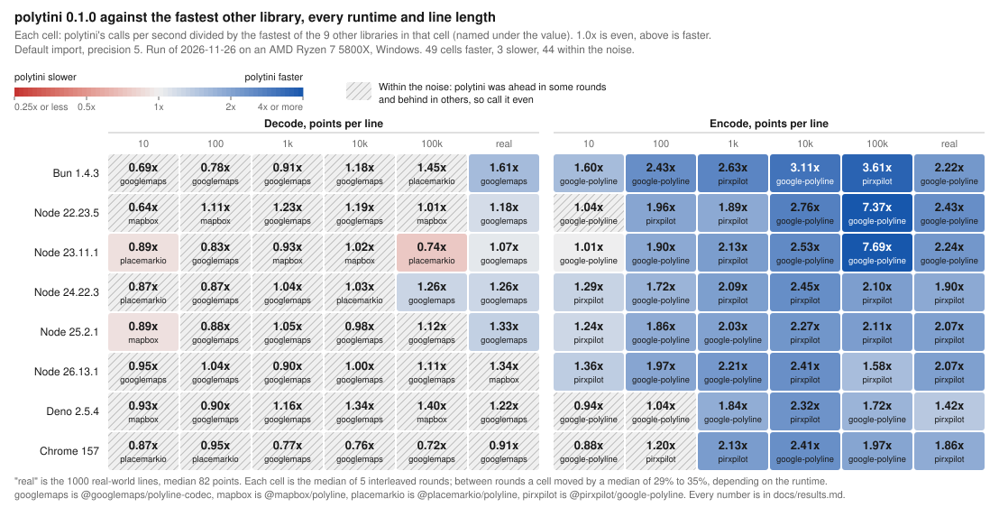
</picture>

<picture>
  <source media="(prefers-color-scheme: dark)" srcset="charts/grouped-decode-dark.svg">
  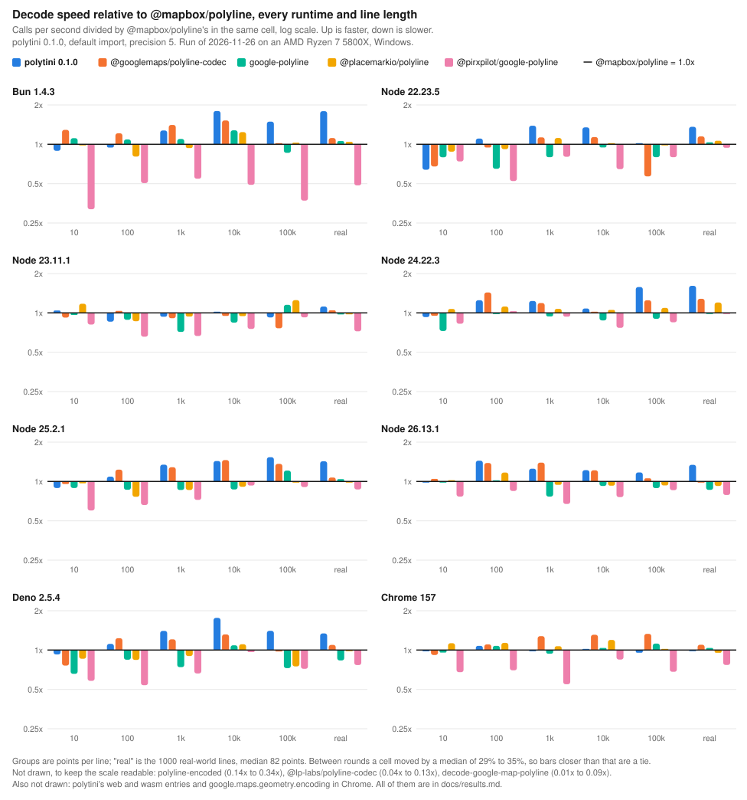
</picture>

<picture>
  <source media="(prefers-color-scheme: dark)" srcset="charts/grouped-encode-dark.svg">
  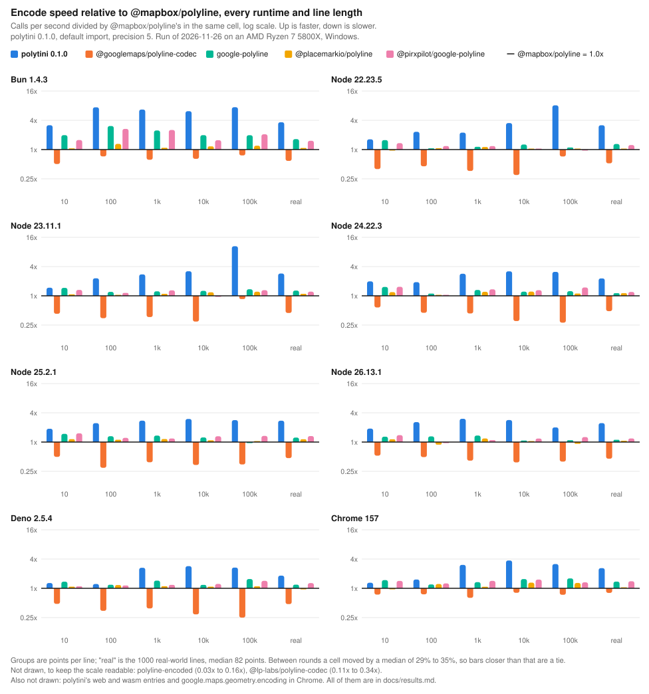
</picture>

## Memory

Allocated per call on Node 24 and Deno, relative to `@mapbox/polyline`. How it's measured: [methodology](methodology.md#memory).

<picture>
  <source media="(prefers-color-scheme: dark)" srcset="charts/memory-decode-dark.svg">
  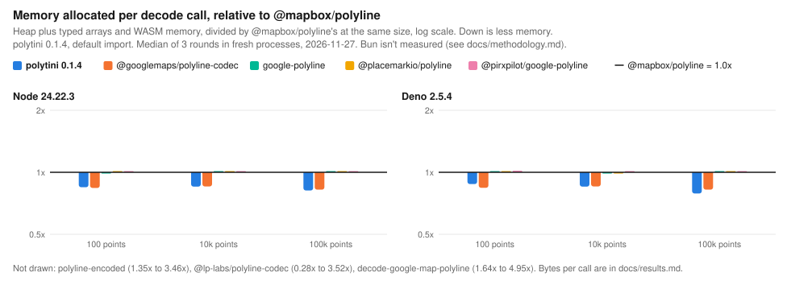
</picture>

<picture>
  <source media="(prefers-color-scheme: dark)" srcset="charts/memory-encode-dark.svg">
  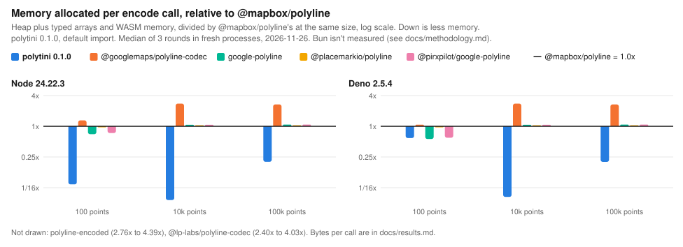
</picture>

## Bundle size

<picture>
  <source media="(prefers-color-scheme: dark)" srcset="charts/size-dark.svg">
  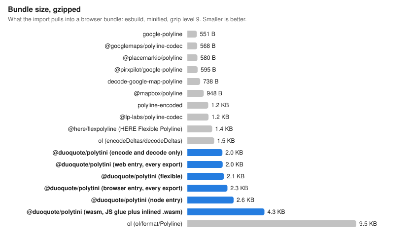
</picture>

## Calls per second, per runtime

Absolute speed by line length for polytini and the two fastest other libraries on that runtime, then every library on the real-world lines.

### Bun

<picture>
  <source media="(prefers-color-scheme: dark)" srcset="charts/ops-bun-decode-dark.svg">
  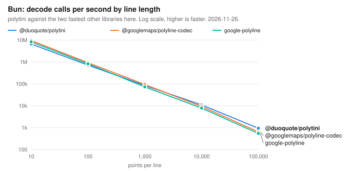
</picture>

<picture>
  <source media="(prefers-color-scheme: dark)" srcset="charts/speed-bun-decode-dark.svg">
  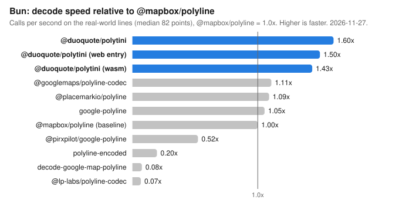
</picture>

<picture>
  <source media="(prefers-color-scheme: dark)" srcset="charts/ops-bun-encode-dark.svg">
  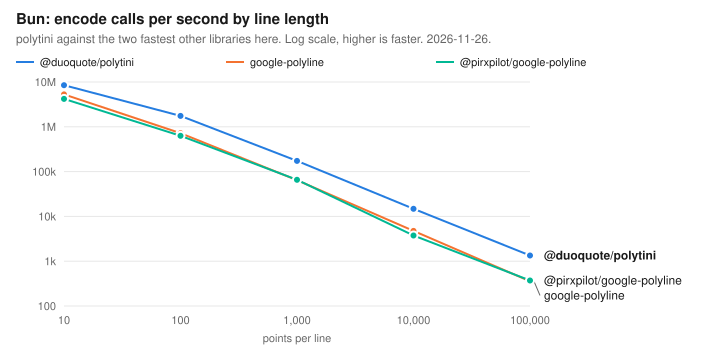
</picture>

<picture>
  <source media="(prefers-color-scheme: dark)" srcset="charts/speed-bun-encode-dark.svg">
  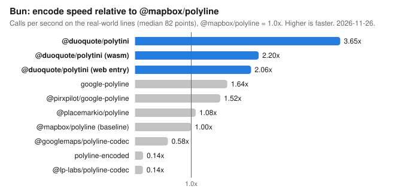
</picture>

### Node 22

<picture>
  <source media="(prefers-color-scheme: dark)" srcset="charts/ops-node-22-decode-dark.svg">
  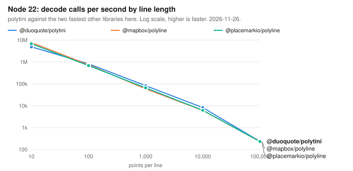
</picture>

<picture>
  <source media="(prefers-color-scheme: dark)" srcset="charts/speed-node-22-decode-dark.svg">
  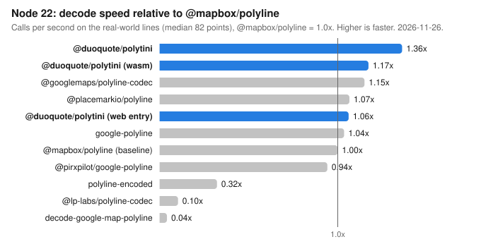
</picture>

<picture>
  <source media="(prefers-color-scheme: dark)" srcset="charts/ops-node-22-encode-dark.svg">
  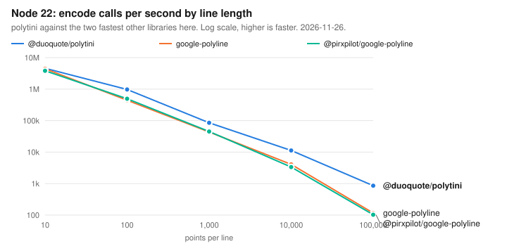
</picture>

<picture>
  <source media="(prefers-color-scheme: dark)" srcset="charts/speed-node-22-encode-dark.svg">
  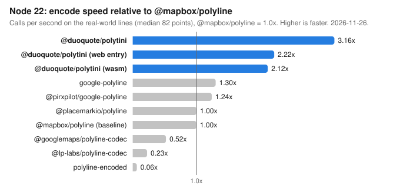
</picture>

### Node 23

<picture>
  <source media="(prefers-color-scheme: dark)" srcset="charts/ops-node-23-decode-dark.svg">
  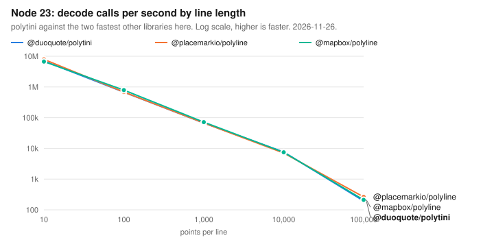
</picture>

<picture>
  <source media="(prefers-color-scheme: dark)" srcset="charts/speed-node-23-decode-dark.svg">
  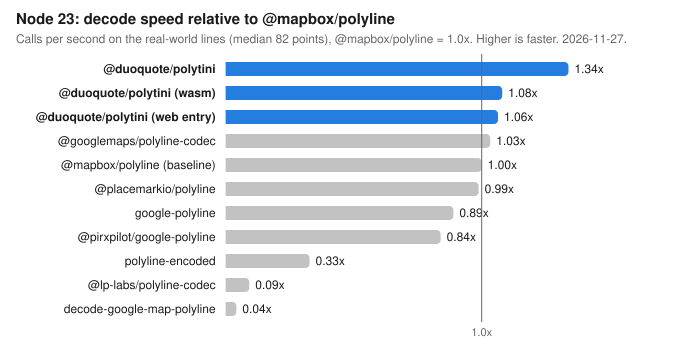
</picture>

<picture>
  <source media="(prefers-color-scheme: dark)" srcset="charts/ops-node-23-encode-dark.svg">
  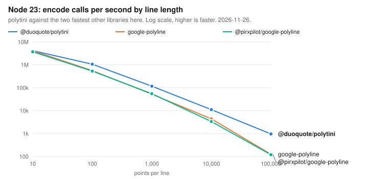
</picture>

<picture>
  <source media="(prefers-color-scheme: dark)" srcset="charts/speed-node-23-encode-dark.svg">
  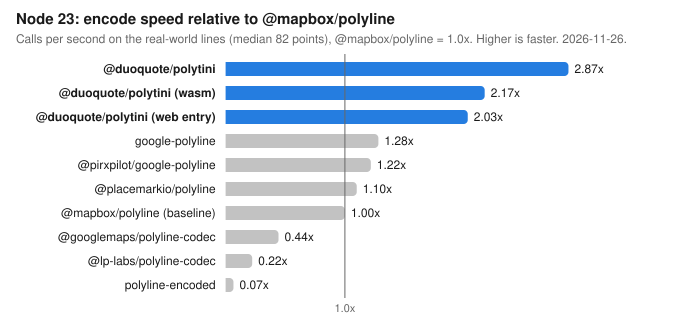
</picture>

### Node 24

<picture>
  <source media="(prefers-color-scheme: dark)" srcset="charts/ops-node-24-decode-dark.svg">
  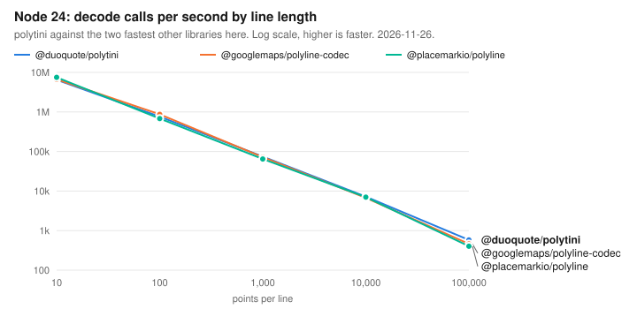
</picture>

<picture>
  <source media="(prefers-color-scheme: dark)" srcset="charts/speed-node-24-decode-dark.svg">
  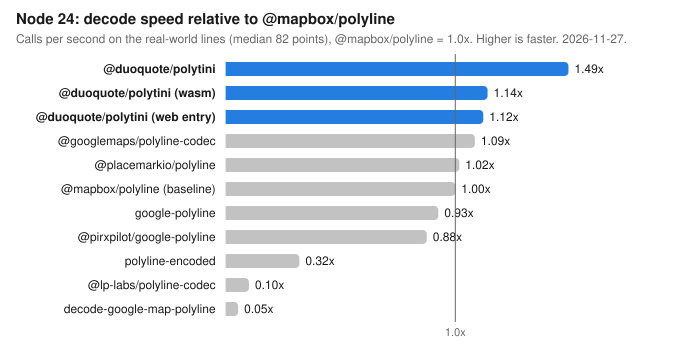
</picture>

<picture>
  <source media="(prefers-color-scheme: dark)" srcset="charts/ops-node-24-encode-dark.svg">
  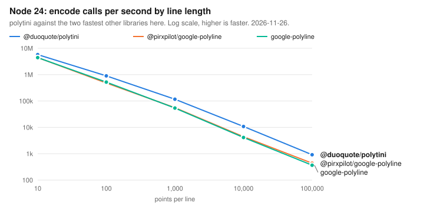
</picture>

<picture>
  <source media="(prefers-color-scheme: dark)" srcset="charts/speed-node-24-encode-dark.svg">
  
</picture>

### Node 25

<picture>
  <source media="(prefers-color-scheme: dark)" srcset="charts/ops-node-25-decode-dark.svg">
  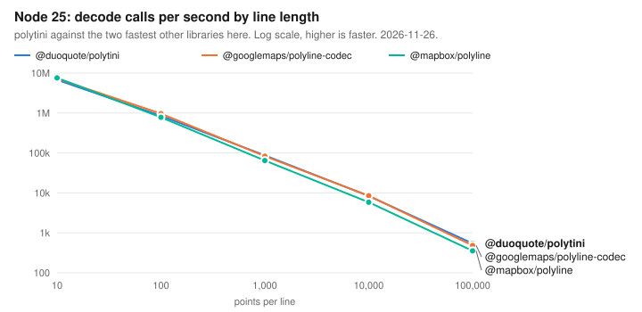
</picture>

<picture>
  <source media="(prefers-color-scheme: dark)" srcset="charts/speed-node-25-decode-dark.svg">
  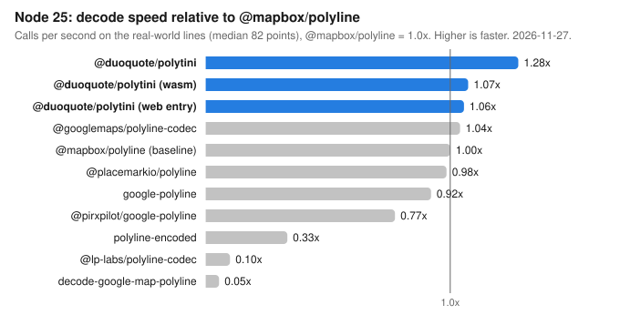
</picture>

<picture>
  <source media="(prefers-color-scheme: dark)" srcset="charts/ops-node-25-encode-dark.svg">
  
</picture>

<picture>
  <source media="(prefers-color-scheme: dark)" srcset="charts/speed-node-25-encode-dark.svg">
  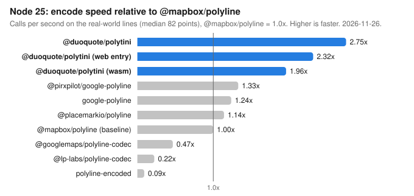
</picture>

### Node 26

<picture>
  <source media="(prefers-color-scheme: dark)" srcset="charts/ops-node-26-decode-dark.svg">
  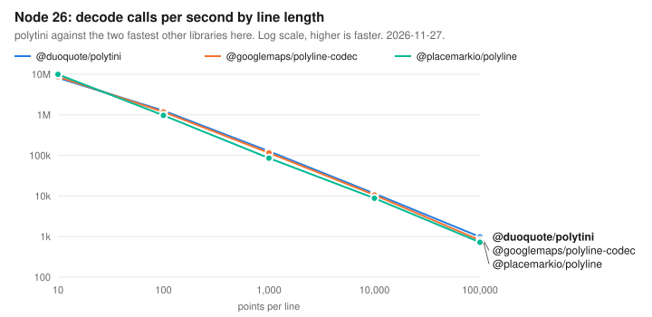
</picture>

<picture>
  <source media="(prefers-color-scheme: dark)" srcset="charts/speed-node-26-decode-dark.svg">
  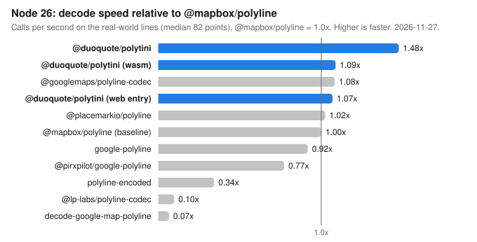
</picture>

<picture>
  <source media="(prefers-color-scheme: dark)" srcset="charts/ops-node-26-encode-dark.svg">
  
</picture>

<picture>
  <source media="(prefers-color-scheme: dark)" srcset="charts/speed-node-26-encode-dark.svg">
  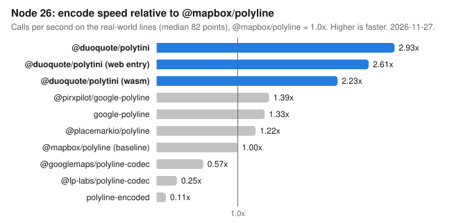
</picture>

### Deno

<picture>
  <source media="(prefers-color-scheme: dark)" srcset="charts/ops-deno-decode-dark.svg">
  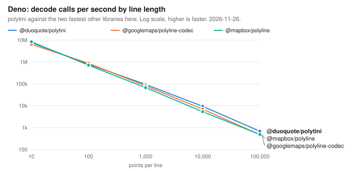
</picture>

<picture>
  <source media="(prefers-color-scheme: dark)" srcset="charts/speed-deno-decode-dark.svg">
  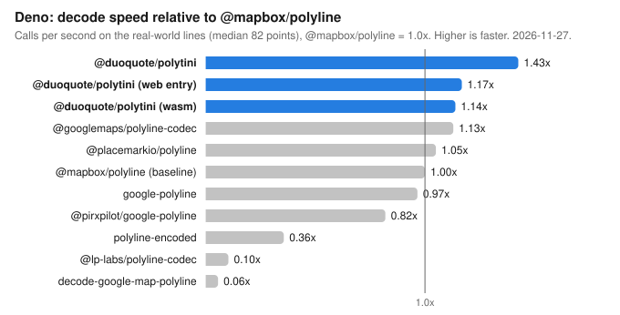
</picture>

<picture>
  <source media="(prefers-color-scheme: dark)" srcset="charts/ops-deno-encode-dark.svg">
  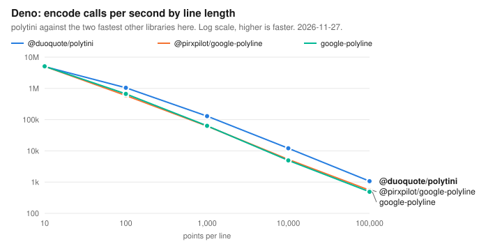
</picture>

<picture>
  <source media="(prefers-color-scheme: dark)" srcset="charts/speed-deno-encode-dark.svg">
  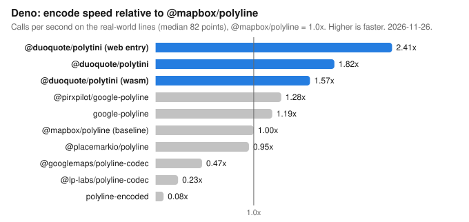
</picture>

### Chrome

<picture>
  <source media="(prefers-color-scheme: dark)" srcset="charts/ops-browser-decode-dark.svg">
  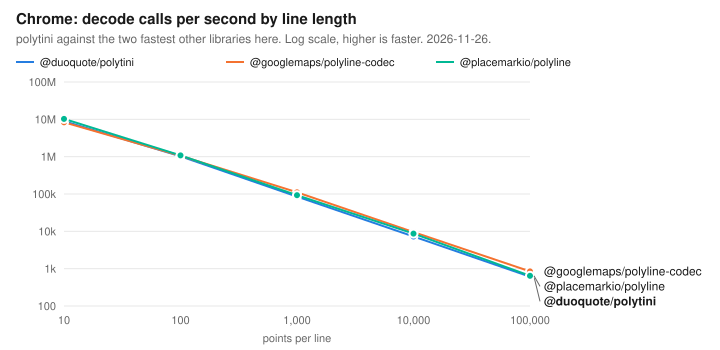
</picture>

<picture>
  <source media="(prefers-color-scheme: dark)" srcset="charts/speed-browser-decode-dark.svg">
  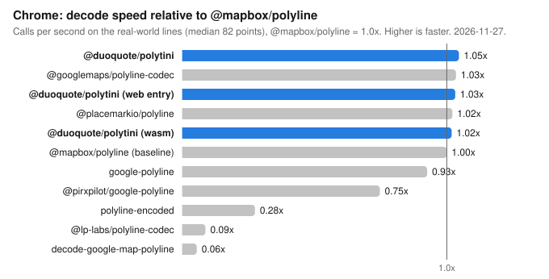
</picture>

<picture>
  <source media="(prefers-color-scheme: dark)" srcset="charts/ops-browser-encode-dark.svg">
  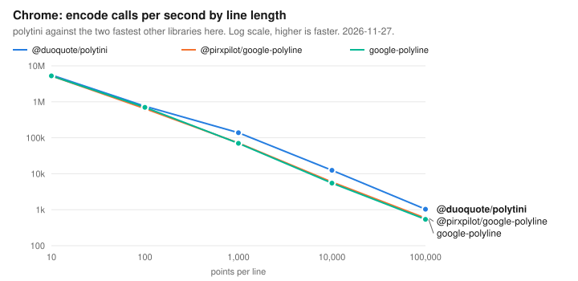
</picture>

<picture>
  <source media="(prefers-color-scheme: dark)" srcset="charts/speed-browser-encode-dark.svg">
  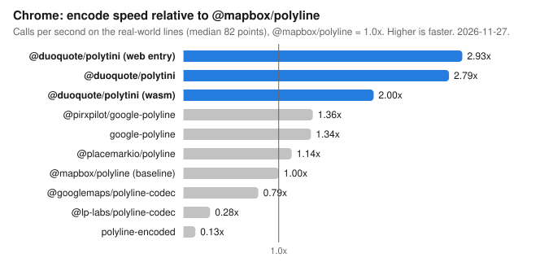
</picture>
